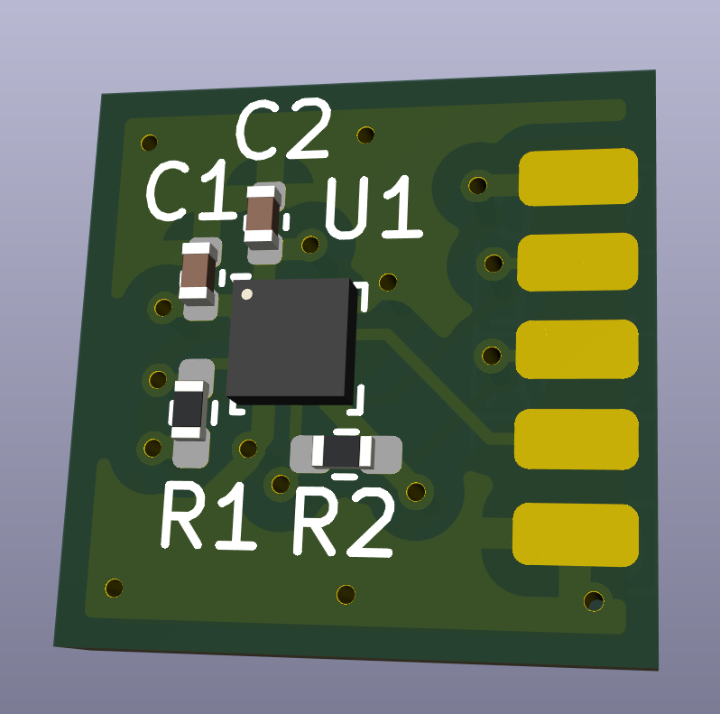

# November 21: Started project

My karate dojo used to have an impact bad that could measure how hard someone punched or kicked which they used for competitions. Now it's either broken or lost, I don't know, but one of them asked me to make a new one. I chatted with my ai to get a rough idea of how it would work. I did say that I say that I didn't use ai for this project and it won't make any of the files, I just used it to get started. Using that, I decided to measure the force by having a pressurized bladder, like a kickball, and measuring the change in pressure upon impact. My ai kept suggesting industrual piezo pressure sensors but they run hundreds or thousands of dolars. I settled with the BMP384 which is a pressure sensor IC and it has a maximum data rate of 200Hz which I think should be just enough. I will have a cord running through the bladder to an external control board with an RPI pico for an MCU and screen to display the pressure. Then the whole rig will go inside of an impact bag.

**Total time spent: 1h**

# November 21: Created pressure board

I started by making the pressure board. Kicad doesn't have the symbol for the BMP384 so I copied it from another one of my projects. At first I wanted to make a single board that would break apart but since the boards are so simple and cheap I decided against it and just have two boards. Since I have worked with this pressure sensor before it was pretty streightforward to get it all done. I ended up with a simple 2 layer 10x10mm board.

**Total time spent: 1h**

